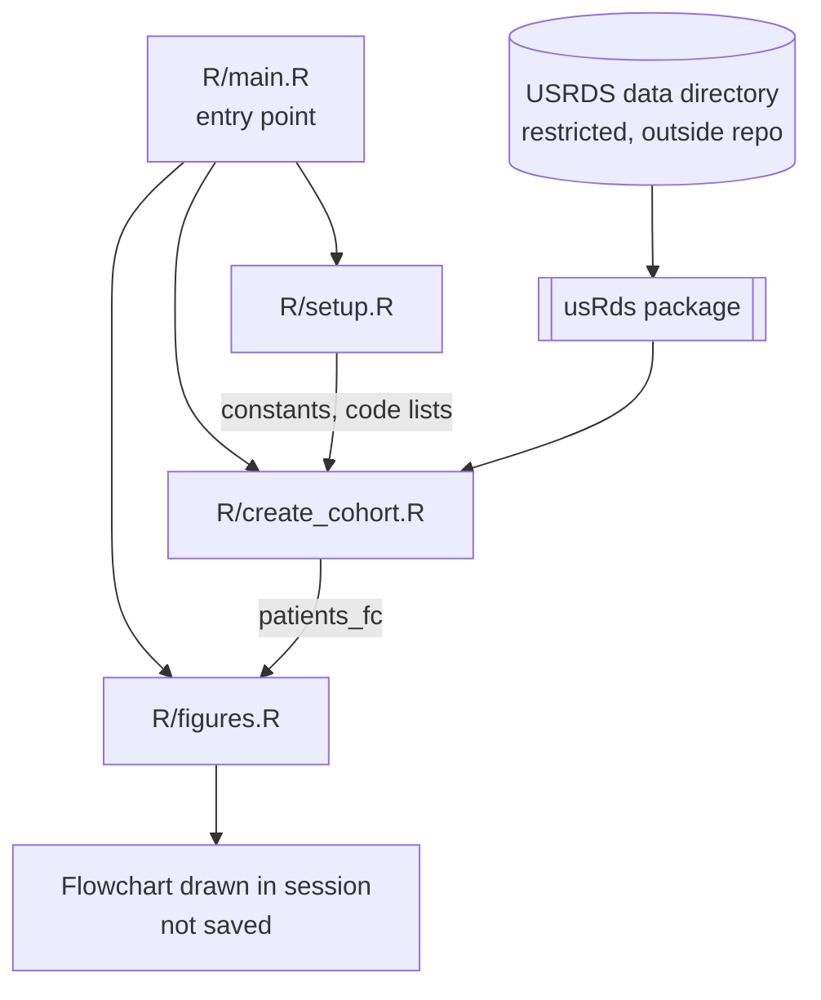
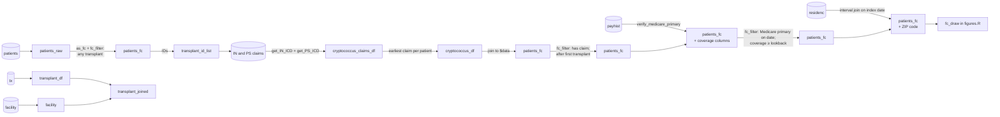

# Architecture

This file describes how the code is organized: the scripts, the order they run in, the objects they pass to one another, and where data comes from. The study design is in `analysis-plan.md`, and the working rules are in `AGENTS.md`.

*Describes `main` at commit `da6409e` (2026-10-24). Update this file whenever scripts, objects, or data flow change.*

## Overview

The analysis is a set of R scripts that run in sequence in one R session. `R/main.R` is the only entry point. It sources:

1. a setup script (libraries, constants, code lists)
2. a cohort-construction script
3. a figures script

All USRDS file access goes through the usRds package. Cohort inclusions and exclusions are recorded with the flowchart package, so the participant flowchart is produced directly from the cohort-building code.

Every object lives in the global environment of the session. The pipeline writes nothing to disk: no intermediate files, and no exported tables or figures. Restricted data are read from the USRDS data directory configured for usRds and stay in memory.

**Current scope.** The code builds a cohort of kidney transplant recipients with a cryptococcosis claim and draws its flowchart. Not yet implemented:

- the missed-opportunity algorithm
- comorbidities
- mortality and geographic analyses
- any Quarto documents

## Architecture diagram

## Data flow

`transplant_df`, `facility`, and `transplant_joined` are built, but they are not yet joined to the cohort. They are dead ends in the current flow.

How the cohort moves through `create_cohort.R`:

1. **Base population.** Load the USRDS patient file, dropping the ZIP code recorded when the patient entered USRDS. Wrap it in a flowchart object, then keep patients with at least one transplant.
2. **Case finding.** Collect the IDs of the patients still in the cohort. Pull institutional and physician/supplier claims that carry a code from the cryptococcosis list, for the claim years in the constants. Combine the two sources, then keep each patient's earliest claim date as `first_cryptococcus_date`.
3. **Attach and filter.** Join that date to the flowchart's data with a one-to-one join. Then apply two flowchart filters: the patient has a claim, and the claim falls after the first transplant date.
4. **Medicare coverage.** `verify_medicare_primary()` adds the start and end dates of the Medicare primary coverage span that contains the index date, plus a TRUE/FALSE flag for whether that span covers the look-back period. A duplicate check stops the run if the join multiplied rows. Two flowchart filters then apply the coverage criteria.
5. **Residence.** An interval join adds the ZIP code valid on the index date, followed by a duplicate check. Patients with no matching residence period are kept, with a missing ZIP code.
6. **Transplant and facility (not connected).** Builds a per-transplant table with the date of the next transplant (a far-future placeholder when there is none), and joins each transplant to facility records by provider and year.

`figures.R` then draws the flowchart from the final `patients_fc`.

## Components

### Entry point

**Purpose:** runs the full pipeline in dependency order.

**Location:** `R/main.R`

**Interactions:** sources `R/setup.R`, `R/create_cohort.R`, and `R/figures.R`, in that order, from the project root.

### Setup

**Purpose:** loads every library, and defines the constants and code lists that the other scripts use.

**Location:** `R/setup.R`

**Labelled sections:** `libraries`, `constants`, `icd-code-lists`, `missed-diagnosis-code-maps`

**Key objects:**

- `claim_years`: the claim years searched
- `lookback_days`: the days of Medicare primary coverage required before the index date
- `icd10_start_date`: the date ICD-10 coding begins (defined but not used yet)
- `cryptococcus_ICD_list`: the ICD-9 and ICD-10 case-finding codes, matched exactly
- `icd9_map`, `icd10_map`, and `icd_combined_map`: symptom, condition, and procedure codes for possible earlier presentations, by category and code type (not used yet)

**Interactions:** provides constants and code lists to `create_cohort.R`. Nothing upstream.

### Cohort construction

**Purpose:** builds the analytic cohort and records each inclusion step in the flowchart.

**Location:** `R/create_cohort.R`

**Labelled sections:** `load-usrds-files`, `initialize-flowchart`, `cryptococcus-claims`, `develop-flowchart`, `medicare-coverage`, `residence-transplant-facility`

**Key objects:**

- `patients_fc`: the flowchart object. Its `$data` element is the cohort, one row per patient.
- `cryptococcus_claims_df`: every cryptococcosis claim for transplant recipients, from both claim sources
- `cryptococcus_df`: the earliest cryptococcosis claim date per patient
- `ZIP_code_df`: residence periods
- `transplant_df`, `facility`, and `transplant_joined`: transplant and facility tables, not yet used downstream

**External functions:**

- usRds: `load_usrds_file()`, `get_IN_ICD()`, `get_PS_ICD()`, `verify_medicare_primary()`
- flowchart: `as_fc()`, `fc_filter()`

**Interactions:** takes constants and code lists from setup, and reads the USRDS files through usRds. Passes `patients_fc` to figures.

### Figures

**Purpose:** draws the participant flowchart.

**Location:** `R/figures.R`

**Labelled sections:** `final-flowchart`

**External functions:** flowchart's `fc_draw()`

**Interactions:** takes `patients_fc` from cohort construction. The diagram is drawn in the session and not exported.

## External dependencies

| Dependency | Role |
|---|---|
| usRds | Locates and reads USRDS files; extracts claims by ICD code; checks Medicare primary coverage. All data access goes through it. |
| flowchart | Records cohort filtering steps and draws the participant flowchart |
| tidyverse, lubridate | Data manipulation and dates |
| USRDS data directory | The restricted source files, outside the repository. Its location is set through usRds outside this code; no script sets it. |

## Configuration

- **Analysis constants:** in `R/setup.R` (see Setup above). Flowchart labels in `create_cohort.R` still hard-code the claim years and the 365-day look-back, so they do not follow the constants.
- **Data location:** set through usRds's own configuration, not in this repository.
- **Ignored files:** `.gitignore` covers RStudio and session files (`.Rproj.user`, `.Rhistory`, `.Rdata`), `.DS_Store`, `.httr-oauth`, and `.quarto`.

## Chunk labels

Each script is divided into sections marked `## ---- label`, so that Quarto documents can load them with `knitr::read_chunk()`. The labels in each script are listed under Components above. No Quarto documents exist yet. `README.Rmd` is the unedited usethis template, and it renders `README.md` together with an example figure in `README_files/`.

## Code references

| Component | File | Key symbols |
|---|---|---|
| Entry point | `R/main.R` | `source()` calls |
| Constants | `R/setup.R` | `claim_years`, `lookback_days`, `icd10_start_date` |
| Code lists | `R/setup.R` | `cryptococcus_ICD_list`, `icd9_map`, `icd10_map`, `icd_combined_map` |
| Cohort and flowchart | `R/create_cohort.R` | `patients_raw`, `patients_fc`, `fc_filter()` |
| Case finding | `R/create_cohort.R` | `get_IN_ICD()`, `get_PS_ICD()`, `cryptococcus_claims_df`, `cryptococcus_df` |
| Coverage | `R/create_cohort.R` | `verify_medicare_primary()`, `medicare_primary_TF`, `coverage_start_date`, `coverage_end_date` |
| Residence | `R/create_cohort.R` | `ZIP_code_df` |
| Transplant and facility | `R/create_cohort.R` | `transplant_df`, `facility`, `transplant_joined` |
| Flowchart figure | `R/figures.R` | `fc_draw()` |

## Glossary

| Term | Meaning in this repository |
|---|---|
| IN claims | USRDS institutional claims: inpatient, outpatient, SNF, home health, and hospice. Not inpatient only. |
| PS claims | USRDS physician/supplier claims |
| `HCFASAF` | The claim-type variable on claims returned by usRds |
| Index date | Currently `first_cryptococcus_date`, the earliest cryptococcosis claim of any type. `analysis-plan.md` defines the intended index date. |
| `patients_fc` | The flowchart object. `patients_fc$data` is the cohort, and its filter history becomes the flowchart. |
| Look-back | The days of continuous Medicare primary coverage required before the index date (`lookback_days`) |
